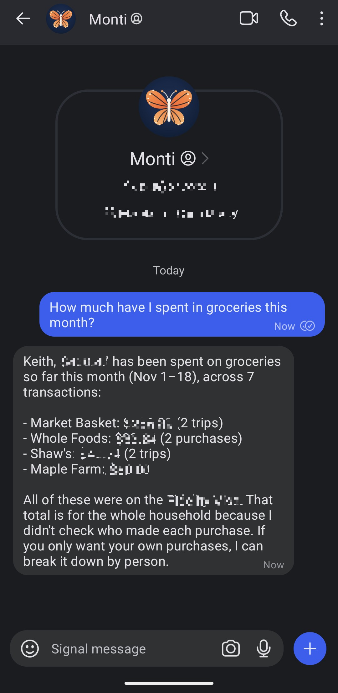
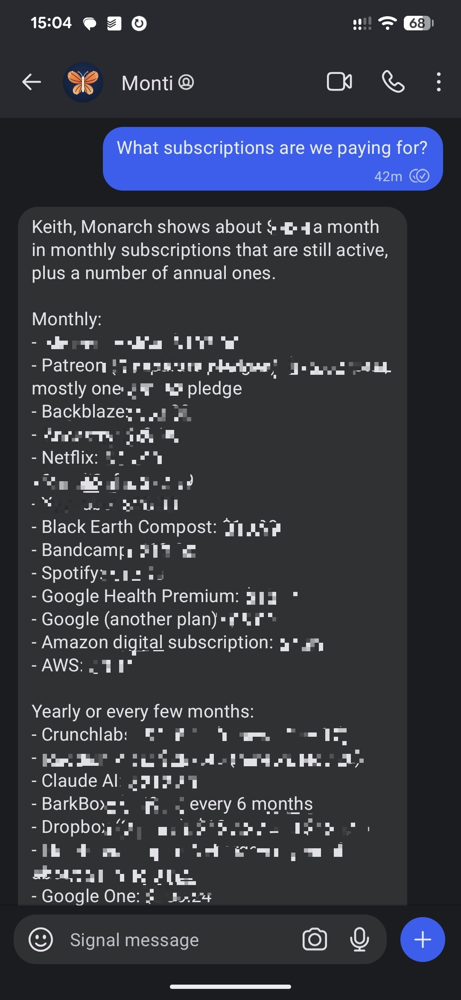
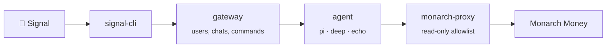

<p align="center">
  
</p>

<h1 align="center">Monti</h1>

<p align="center">
  <strong>Your household's money, one text away.</strong><br>
  A self-hosted Signal bot that answers questions about your Monarch Money finances.
</p>

---

Monti is a butterfly you text for money advice. You ask in plain English, in a DM or in the
family group chat, and Monti looks up the real numbers in your [Monarch Money](https://www.monarchmoney.com)
account and texts back a short answer. There's no app to open and no dashboard to dig through.

<p align="center">
  
  &nbsp;
  
</p>

## What you can ask

> **You:** How much have we spent on groceries this month?
>
> **Monti:** $612.40 so far in November, across 14 transactions. That's $88 under your $700
> grocery budget, with 12 days to go.

Some other things Monti can answer:

- "What's our checking balance?"
- "Did the Comcast bill go up?"
- "What subscriptions are we paying for?"
- "How's net worth looking compared to January?"
- "Are we over budget on anything?"
- "What was that $240 charge at Target last week?"

Monti reads balances, transactions, budgets, cash flow, recurring bills, goals, investments and
net worth history. It can't move money or change anything in Monarch.

## Why Monti

- **It works in Signal.** Everyone in the house already has their phone, so there's nothing new
  to install. Messages are end-to-end encrypted on the way to your server.
- **It's built for a household.** Each person is listed by name, so Monti knows who's asking.
  It works in DMs and in group chats, and each chat keeps its own conversation history.
- **It's read-only.** Monti uses Monarch's read-only OAuth scope, and a proxy in front of
  Monarch allows only 17 read tools and refuses everything else.
- **It keeps quiet around outsiders.** Monti replies in a group only when every other member is
  on your list. If anyone else is in the group, Monti says nothing.
- **You host it.** It runs on your own machine with Docker Compose and your own Anthropic API
  key. Your data stays between your server, Monarch and Anthropic.
- **The agent is swappable.** Switch agents from Signal with `/agent`: `pi`
  ([Pi](https://github.com/badlogic/pi-mono)), `deep` ([deepagents](https://github.com/langchain-ai/deepagents)),
  or `echo` for testing.

## How it works



The **gateway** receives Signal messages, drops anyone not on the list, and routes each chat to
its agent. The **agent** is Claude plus the Monarch tools and nothing else: no shell and no
filesystem. The **monarch-proxy** holds the Monarch OAuth tokens, enforces the read allowlist and
logs every call.

## Quick start

You'll need:

- Docker with Compose v2
- [mise](https://mise.jdx.dev/) (run `mise install` once to get Node 22, Python 3.13 and uv)
- A phone number for the bot (a spare SIM works) and an [Anthropic API key](https://console.anthropic.com)
- A Monarch Money account

```sh
cp .env.example .env          # add ANTHROPIC_API_KEY, USERS, BOT_NUMBER
mise run monarch-login        # OAuth into Monarch (opens a browser, port 8765)
                              # register the bot's number: docs/runbooks/signal-registration.md
mise run up                   # start everything
```

Then text the bot `hi` from your phone. 🦋

`mise run logs` follows the logs and `mise run down` stops everything. `mise run set-avatar [image]`
sets Monti's Signal profile picture (by default `assets/monti-avatar.png`).
`docs/runbooks/manual-checks.md` is the full acceptance script.

## Configuration

All settings live in `.env`:

| Variable        | What it does                                                         |
| --------------- | -------------------------------------------------------------------- |
| `ANTHROPIC_API_KEY` | Your Anthropic API key.                                          |
| `USERS`         | Who Monti answers (see below).                                       |
| `BOT_NUMBER`    | The bot's Signal number in E.164 format, e.g. `+16175550199`.        |
| `BOT_UUID`      | Optional. The bot's Signal ACI, so group checks recognise it by uuid. |
| `MODEL`         | The Claude model the agents use.                                     |
| `DEFAULT_AGENT` | `pi`, `deep` or `echo`.                                              |

### Users

`USERS` is a comma-separated list of `Name=+E164[/uuid]`:

```sh
USERS=Keith=+16175550100,Alex=+16175550101/0b8a3c1e-1d2f-4a5b-9c6d-7e8f9a0b1c2d
```

The name is what Monti sees on each message's `From:` line, so it can answer people by name. The
uuid (the person's Signal ACI) is optional. Add it if someone's messages arrive without a phone
number, for example because they hide their number from people who don't have it. Anyone not
listed gets no reply.

### Chats and groups

Each DM with Monti and each group Monti is in is its own chat, with its own agent, session and
memory. To use Monti in a group, add the bot's number to a Signal group like any other contact. A
group with just you and Monti works as a separate thread. In an allowed group Monti answers every
message, with no mention needed. Chats run independently: a slow answer in one doesn't hold up
another, and messages within a chat are answered in order.

**Group security rule.** Monti's answers show the household's finances to everyone in the
group, so Monti speaks in a group only when every member other than Monti is in `USERS`. If
anyone else is in the group, or has been invited to it, Monti stays silent, even when someone on
the list writes. The check is fail-closed: if signal-cli can't list the group's members (because
of an error, a timeout, an unknown group, or a member it can't identify), Monti stays silent and
logs why. Membership is cached for 60 seconds per group and refreshed when the group changes.

## Signal commands

| Command         | What it does                                       |
| --------------- | -------------------------------------------------- |
| `/agent <name>` | Switch this chat's agent (`pi`, `deep`, `echo`).   |
| `/new`          | Start a fresh session with the current agent.      |
| `/which`        | Show the current agent, session and model.         |
| `/help`         | List the commands.                                 |

Commands apply to the chat you send them in. In a group, whoever sends a command changes it for
everyone there. Anything else is a question for the agent. If the Monarch login expires, Monti
tells you; run `mise run monarch-login` again.

### Changing Monti's personality

Monti's instructions live in `prompts/system.md`. After you edit it, run
`docker compose restart agent-pi agent-deep`, since the agents read the prompt at startup. Then
send `/new` in each chat that uses Pi. Pi stores the prompt in each session and sends a changed
one as a mid-conversation "system update", which the model may treat as an injection and ignore.
deepagents doesn't store the prompt in its checkpoints, so its existing sessions pick up the new
one.

## Security

- Monarch access uses the read-only `mcp:read` OAuth scope. The proxy exposes only a 17-tool read
  allowlist (`monarch-proxy/src/monarch_proxy/allowlist.py`) and refuses everything else.
- Monti answers only people in `USERS`. In groups it also requires every other member to be in
  `USERS`, and the check fails closed.
- Pi starts with zero built-in tools (no bash, read, write or edit). Its only tools are the
  Monarch ones.
- deepagents uses its in-memory backend only, never a host-filesystem backend.
- The only published port is the proxy's, on `127.0.0.1:8100`, for debugging.

## Where things live

| Path                                  | Contents                                                                 |
| ------------------------------------- | ------------------------------------------------------------------------ |
| `data/gateway/gateway.db`             | SQLite. One row per question in `turns`: chat, sender, agent, reply, tool calls, tokens. |
| `data/logs/monarch-calls.jsonl`       | One line per Monarch tool call: tool, args, ms, ok, size. Never the results. |
| `data/agents/pi/<session_id>/`        | Pi session state.                                                        |
| `data/agents/deep/checkpoints.db`     | deepagents session state.                                                |
| `data/monarch/tokens.json`            | Monarch OAuth tokens (mode 0600).                                        |
| `data/signal/`                        | Signal credentials. **Back this up**; losing it means re-registering.    |

`data/` and `.env` are gitignored. Check the Monarch tokens without logging in again with
`uv run monarch-login --check`.

## Development

- `mise run test` runs the unit tests for every Python package.
- `mise run contract` starts fake-monarch and each agent locally, then runs the contract suite
  (`contract/tests`) against echo, Pi and deep. It loads `.env` if present and runs the LLM tests
  only when `ANTHROPIC_API_KEY` is set (otherwise it says so and runs the rest).
- Pi's own tests: `cd agents/pi && npm ci && npm test`.

The design docs are in `docs/superpowers/specs/`: `2026-11-04-signal-monarch-agent-design.md`,
amended by `2026-11-05-monty-chats-and-mise-design.md` (users, chats and groups).

### Upgrading from v1 (single owner)

`OWNER_NUMBER` and `OWNER_UUID` were replaced by `USERS`, and the gateway won't start until you
add a `USERS` line. The gateway schema has no migrations, so delete `data/gateway/` before the
first run. Leave `data/monarch/`, which holds your Monarch login.
